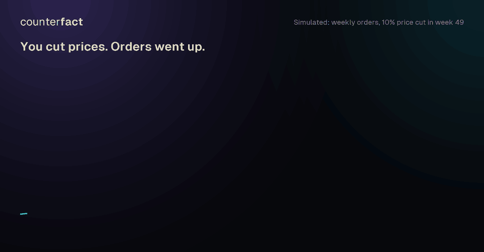
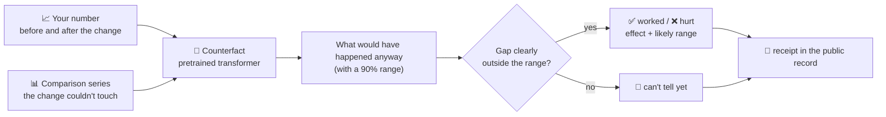
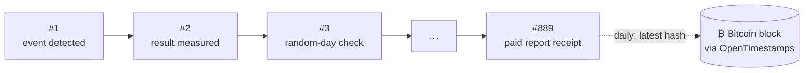
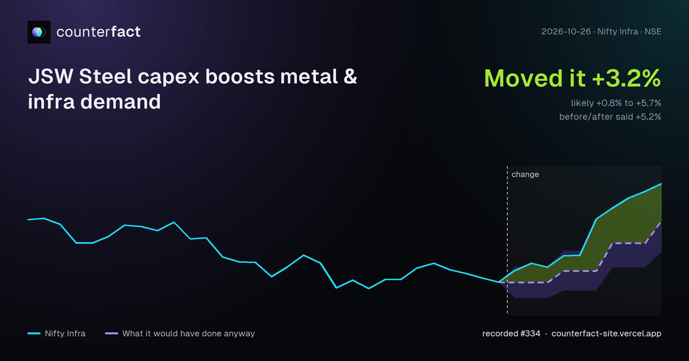

<div align="center">


# Counterfact

### Did your change actually work?

A pretrained model that tells you what your numbers would have done **without** your price cut, campaign or policy,<br>
so you can see the part your change actually caused. Every result can be checked in a public record anchored on Bitcoin.

[](https://github.com/rudraneel93/counterfact/actions/workflows/test.yml)
[](https://pypi.org/project/counterfact/)
[](https://pypi.org/project/counterfact/)
[](LICENSE)
[](https://huggingface.co/Rudraneel93/counterfact-v2)
<br>
[](https://counterfact-site.vercel.app/verify)
[](https://opentimestamps.org)
[](https://counterfact-site.vercel.app)

<br>



<sub>Simulated data with a known true effect of +7.0%. The purple band and the +7.7% are the open model's real output.</sub>

[**Try it in the browser**](https://counterfact-site.vercel.app/#playground) · [**Market board**](https://counterfact-site.vercel.app/board) · [**Claim Check**](https://counterfact-site.vercel.app/claim) · [**Public record**](https://counterfact-site.vercel.app/verify) · [**API**](https://rapidapi.com/RudraneelDas/api/counterfact)

</div>

---

## Why before-vs-after lies

Most reports compare the weeks after a change with the weeks before. That counts everything else that was happening, such as a trend, a season or a market-wide move, as your effect. In the animation above, orders were already rising, so before-vs-after says **+11.1%** when the price cut caused about **+7%**.

Counterfact predicts the path your number would have taken anyway, using its own history and any comparison series the change couldn't have touched (other regions, other products, a market index). The gap between what happened and that path is the effect. It comes with a range that holds about 9 times in 10, and an honest **"can't tell yet"** when the data can't separate the two.

<table>
<tr>
<td width="33%" valign="top">

**🧠 Pretrained, no fitting**

A transformer trained on millions of simulated worlds where the true effect is known, then calibrated on 1,200 real Indian and US data windows. You send a series and get an answer in seconds.

</td>
<td width="33%" valign="top">

**📏 Honest ranges**

The likely range holds about 9 times in 10 on real data. Too small to detect? It says "can't tell yet" instead of guessing.

</td>
<td width="33%" valign="top">

**⛓️ Results you can check**

Results are chained in a public record and timestamped on Bitcoin daily. Nothing can be edited, deleted or back-dated without it showing.

</td>
</tr>
</table>

## Quick start

```bash
pip install counterfact              # API client, no dependencies
pip install "counterfact[local]"     # + run the open model on your own machine
```

```python
import pandas as pd
from counterfact import Local        # offline: no key, your data never leaves your computer

df = pd.read_csv("weekly_orders.csv")            # columns: week, orders, region_b, region_c
r = Local().analyze(df, metric="orders", change_at="2026-03-02", time_col="week",
                    comparisons=["region_b", "region_c"])
print(r.verdict, r.effect, r.likely_range)       # "worked" / "hurt" / "can't tell yet", effect per period, (low, high)
```

<details>
<summary><b>Hosted API (newest production model, robustness checks, plain-language explanation)</b></summary>

```python
from counterfact import Client
cf = Client(api_key="YOUR_KEY")                  # or Client(rapidapi_key="...")
r = cf.analyze(df, metric="orders", change_at="2026-03-02", time_col="week")
print(r)              # verdict, effect, likely range, fake-date checks, leave-one-out checks
print(r.explanation)
r.plot()
```
</details>

<details>
<summary><b>Plain HTTP</b></summary>

```bash
curl -s https://mastyf-support--counterfact-api-api.us-east.modal.run/v1/effect \
  -H 'content-type: application/json' \
  -d '{"target": [412,418,409,425,431,428,436,440,438,447,452,449,481,490,488,497],
       "t0": 12}'
# -> {"cf_median": [449.99, 450.21, …], "effect_mean": 38.08, "effect_lo90": 23.25, …}
```
`t0` is the 0-based index of the first period after the change.
</details>

<details>
<summary><b>Google Sheets and Excel</b></summary>

```text
=CF_EFFECT(B2:B60, 46, C2:E60)     Google Sheets  ->  worked   41.2   18.5   63.9   9.8%
=CF.EFFECT(B2:B60, 46, C2:E60)     Excel          ->  same, spilled into five cells
```
Install guides: [`spreadsheets/`](spreadsheets) or [counterfact-site.vercel.app/sheets](https://counterfact-site.vercel.app/sheets).
</details>

## How it works



## A public record anyone can check



<sub>The chain and anchor checks below are real runs against the live record on 2026-11-10.</sub>

Each entry is chained to the one before it, so changing any old entry breaks every hash after it:

```text
body_hash = sha256(body)
hash      = sha256(f"{seq}|{kind}|{at}|{prev}|{body_hash}")
```

What goes in:
- **Every market-board event, written down when it's detected, before its effect is known**, then its result.
- **Random "nothing happened" days**, measured the same way, so the false-alarm rate is public. It's currently on the [board](https://counterfact-site.vercel.app/board).
- **Every paid report, API result, pre-registered change and Claim Check.** Customer data appears only as a sha256 fingerprint.

Don't trust us, check it. [`verify/counterfact_verify.py`](verify) uses only the Python standard library:

```console
$ python verify/counterfact_verify.py chain
OK: all 889 entries (#1 to #889) are intact and linked.

$ python verify/counterfact_verify.py anchor 2026-11-10
OK: the 2026-11-10 anchor covers entries 1 to #889; its text, hash and proof match.

$ python verify/counterfact_verify.py receipt <receipt id>      # from a report, badge or Claim Check page
OK: entry #… is intact, and every entry from it to #… links up to the hash anchored on <day>.
```

The last step, checking that the proof is in a Bitcoin block, uses the official [OpenTimestamps](https://opentimestamps.org) client: `pip install opentimestamps-client`, then `ots verify anchor-2026-11-10.txt.ots`.

## Every result is shareable



Links to Market board events and Claim Checks unfurl as cards like this on X, LinkedIn, WhatsApp and Slack. Paid results also get a badge for decks, reports and READMEs, which links to the receipt:


```markdown
[](https://counterfact-site.vercel.app/verify?r=<receipt>)
```

## How well it works, and where it doesn't

| Test | Result |
|---|---|
| **Real data:** 1,200 Indian and US windows, placebo dates | 90% range held **about 90%** of the time · about **10% false alarms** |
| **Big effects** (2+ standard deviations) | detected **93%** of the time |
| **Small effects** (0.5–1 standard deviation) | detected **46%** of the time; the rest come back "can't tell yet" |
| **Smooth vs noisy series** (thirds by roughness) | **79%** detected on the smoothest third · **48%** on the noisiest |
| **[DoTime](benchmarks/dotime) `dot-Identifiability-v1`** (independent, 800 episodes, 9 causal structures, open model) | 90% range covered the truth **93%** of the time · sign right in **82.7%** (naive before/after: 83%) |

DoTime forecasts *before* an intervention and Counterfact measures *after* it, so the last row is not a head-to-head on the same task. All scripts and raw results are in [`benchmarks/dotime`](benchmarks/dotime).

## What's in this repo

| | |
|---|---|
| 🔍 [`verify/`](verify) | Stand-alone checker for the public record (standard library only) |
| 🐍 [`python/`](python) | The `counterfact` package: API client and `Local()` for the open model |
| 📊 [`spreadsheets/`](spreadsheets) | `=CF_EFFECT()` for Google Sheets, `=CF.EFFECT()` for Excel |
| 🎓 [`teaching/`](teaching) | 60–90 minute lab: score before/after, diff-in-diff and Counterfact on 300 worlds with known effects. [Open in Colab](https://colab.research.google.com/github/rudraneel93/counterfact/blob/main/teaching/counterfact_teaching_kit.ipynb) |
| 📐 [`benchmarks/dotime/`](benchmarks/dotime) | Reproducible run on DoTime's independent benchmark |
| ✅ [`tests/`](tests) | Tamper tests for the verifier (edited, re-hashed and deleted entries; wrong proofs) |

## Licences

- **Code in this repository:** MIT ([`LICENSE`](LICENSE)).
- **Open model weights** ([`counterfact-v2`](https://huggingface.co/Rudraneel93/counterfact-v2)): CC BY-NC 4.0. Free for research and teaching; for commercial use, use the [API](https://rapidapi.com/RudraneelDas/api/counterfact).
- **Teaching dataset** ([`counterfact-worlds`](https://huggingface.co/datasets/Rudraneel93/counterfact-worlds)): CC BY 4.0.

<div align="center">
<sub>Found a result you think is wrong? <a href="https://github.com/rudraneel93/counterfact/issues">Open an issue</a> or email rudraneel93@gmail.com. Measured claims should be challengeable.</sub>
</div>
